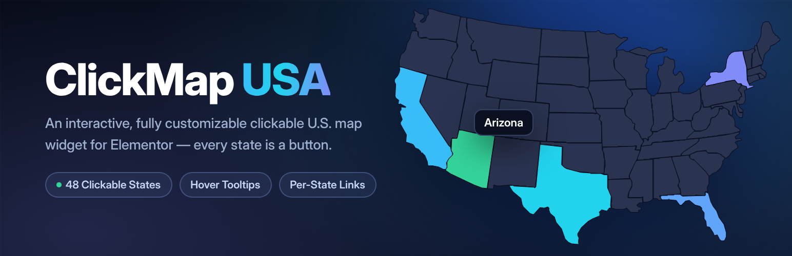
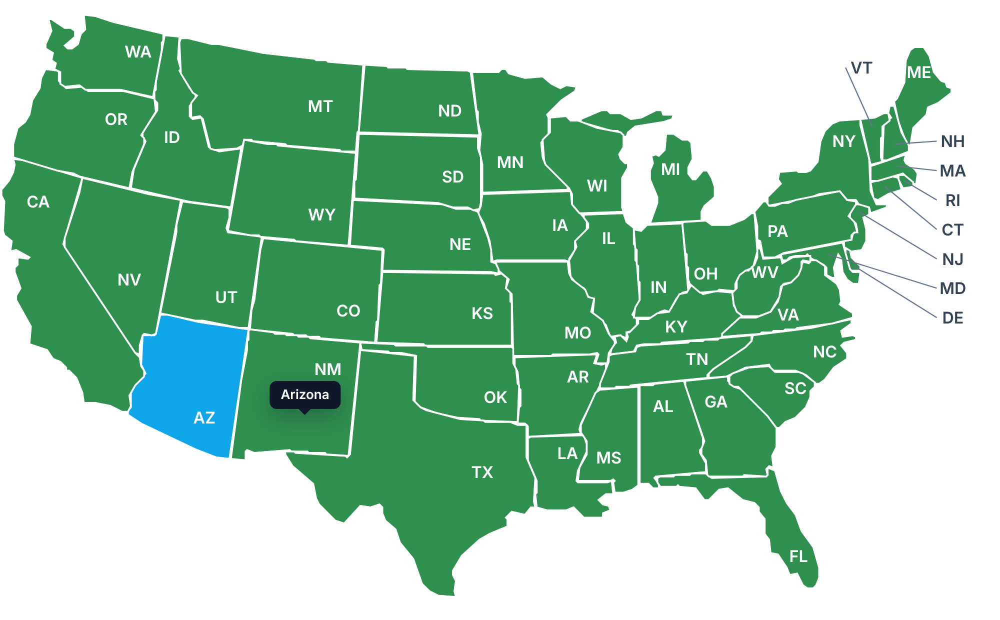

<div align="center">



# ClickMap USA for Elementor

**An interactive, fully customizable clickable U.S. map widget for Elementor — every state is a button.**

[](https://wordpress.org/)
[](https://elementor.com/)
[](https://www.php.net/)
[](https://www.gnu.org/licenses/gpl-2.0.html)
[](#-performance--footprint)

</div>

---

## Overview

ClickMap USA turns a U.S. map into a native Elementor widget where **every state is a real, focusable button**. Hover a state to reveal its name, click it to open the link you assigned, and style any state individually — all without touching code.

It is built as a proper Elementor widget, not an embed or an iframe: the map is **inline SVG**, so it scales perfectly at any size, inherits your theme's typography, and is styled entirely through native Elementor controls.



---

## ✨ Features

| | |
|---|---|
| 🗺 **Every state is a button** | Each state is an individual, clickable, keyboard-focusable element with its own link. |
| 💬 **Hover tooltips** | The state name follows the cursor, with full control over colors, typography and radius. |
| 🎨 **Per-state styling** | Give any single state its own fill and hover fill — supports Elementor **Global Colors**. |
| 🏷 **Precision labels** | Abbreviations sit at each state's *pole of inaccessibility*, so they always land correctly inside the shape — even Michigan's split peninsulas. |
| 🧭 **Smart small-state labels** | RI, DE, NJ, CT, MA, MD, VT and NH are labelled beside the map with leader lines, ordered so the lines never cross. |
| 📱 **Truly responsive** | Inline SVG scales fluidly to any container, at any breakpoint. |
| ⌨️ **Accessible** | Keyboard focus, <kbd>Enter</kbd>/<kbd>Space</kbd> activation, ARIA labels and `prefers-reduced-motion` support. |
| 🔌 **Developer friendly** | Swappable map file, a filter hook, and a JavaScript event for custom click handling. |
| 🪶 **Zero dependencies** | No jQuery requirement, no external libraries, no API keys, no network calls. |

---

## 📦 Installation

1. Download the latest release `.zip`.
2. In WordPress go to **Plugins → Add New → Upload Plugin**.
3. Choose the zip, click **Install Now**, then **Activate**.

**Requirements:** WordPress 5.8+ · PHP 7.2+ · Elementor (free) 3.5+

> **Updating from an older copy?** WordPress will not overwrite an already-installed plugin via upload. Deactivate and **delete** the old version first, then upload the new zip.

---

## 🚀 Usage

1. Edit any page with Elementor.
2. Search the widget panel for **ClickMap USA** (under the **ClickMap** category) and drag it onto the page.
3. Open **Content → State Links**, click **Add Item**, pick a state and set its URL.
4. Style everything under the **Style** tab.

States without a link row stay hoverable buttons — they fire a JavaScript event instead of navigating, so you can open a modal or filter content yourself.

### Controls at a glance

<table>
<tr><th align="left">Content → Map Settings</th><th align="left">Content → State Links</th></tr>
<tr valign="top"><td>

- Map max width
- Alignment (responsive)
- Show state labels
- Hover tooltip on/off
- Open links in new tab

</td><td>

- State selector
- Link (+ new tab / nofollow)
- Tooltip label override
- Custom fill *(per state)*
- Custom hover fill *(per state)*

</td></tr>
<tr><th align="left">Style → States</th><th align="left">Style → Tooltip &amp; Labels</th></tr>
<tr valign="top"><td>

- Fill, border color & width
- Hover fill, border & width
- Hover lift effect
- Transition speed
- Padding, background, box-shadow

</td><td>

- Tooltip background, text, typography
- Tooltip padding & radius
- Label color (on map / small states)
- Leader line color & width

</td></tr>
</table>

---

## 🧩 Developer notes

### Handle clicks in your own JavaScript

States **with** a link navigate normally. States **without** a link dispatch a custom event:

```js
document.addEventListener('clickmap:stateClick', function (e) {
  console.log(e.detail.state); // "CA"
  console.log(e.detail.name);  // "California"
  // open a modal, filter posts, load content...
});
```

### Swap in a different map

The map is a single SVG at `assets/us-states.svg`. Replace it with any U.S. SVG where **each state path carries its two-letter code as an `id`** (`id="CA"`); `data-abbr` and `data-id` also work, and `<g id="CA">` wrappers are flattened automatically.

```php
add_filter( 'clickmap_usa_svg_path', function ( $path ) {
    return get_stylesheet_directory() . '/maps/my-us-map.svg';
} );
```

The bundled map ships with hand-tuned label positions. A swapped-in map is detected automatically and falls back to JavaScript label placement, so nothing breaks.

### Project structure

```
clickmap-usa-for-elementor/
├── clickmap-usa-for-elementor.php   Bootstrap, Elementor/PHP checks, asset registration
├── includes/
│   ├── usa-map-data.php             Canonical state list (abbr => name)
│   ├── usa-map-labels.php           Label anchors + outside-label leader geometry
│   └── legacy-widget.php            Hidden alias keeping pre-rename pages working
├── widgets/
│   └── usa-map-widget.php           The Elementor widget (controls + render)
├── assets/
│   ├── us-states.svg                The map — swappable
│   ├── css/usa-map.css              Front-end styles
│   └── js/usa-map.js                Tooltip, keyboard, click event, label fallback
├── .wordpress-org/                  Banner, icon & screenshot assets
└── docs/                            README artwork
```

---

## ⚡ Performance & footprint

- **No JavaScript dependencies** — a few KB of vanilla JS, no jQuery requirement.
- **Conditional loading** — CSS and JS are registered up front but only enqueued on pages where the widget is actually used.
- **No external requests** — the map is local inline SVG; no tile servers, CDNs or API keys.
- **Safe SVG handling** — the map file is parsed with `DOMDocument` and re-emitted as escaped markup; the raw file is never echoed.

---

## 🗺 About the bundled map

The included map covers the **48 contiguous states**. Alaska, Hawaii and DC are not part of the bundled artwork — swap in your own SVG (see above) if you need them.

States are separated by a thin gap so the border reads cleanly; set **Style → States → Border Width** to `0` for seamless fills.

---

## 👤 Author

**Amanullah Khan** — Full-Stack Developer · PHP &amp; API Integrations · AI Automation

📍 Lahore, Punjab, Pakistan

[](https://github.com/amanullahykhan)
[](https://www.linkedin.com/in/amanullahykhan)

10+ years building WordPress sites, custom plugins, Elementor widgets, API integrations and workflow automation.

---

## 📄 License

Released under the [GPL-2.0-or-later](https://www.gnu.org/licenses/gpl-2.0.html) license — the same license as WordPress.

---

## 📝 Changelog

### 1.3.0
- Renamed to **ClickMap USA for Elementor**.
- Fixed misaligned state labels: each label now sits at the state's pole of inaccessibility, so it is always inside the shape (Michigan's label no longer lands in Lake Michigan).
- Small states (RI, DE, NJ, CT, MA, MD, VT, NH) are labelled beside the map with non-crossing leader lines.
- New controls: *Label Color (small states)*, *Leader Line Color*, *Leader Line Width*.

### 1.2.0
- Fixed per-state **Custom Fill / Custom Hover Fill** not applying. Colors now use Elementor's native repeater CSS, so **Global Colors** work alongside custom values.

### 1.1.0
- Hardened per-state color output.
- Added support for grouped (`<g id="XX">`) SVGs when swapping the map.

### 1.0.0
- Initial release: clickable, responsive U.S. map widget for Elementor with hover tooltips, per-state links and full styling controls.
